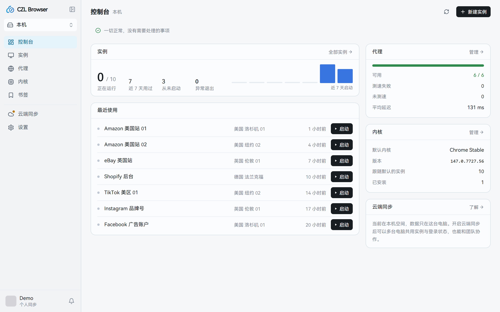
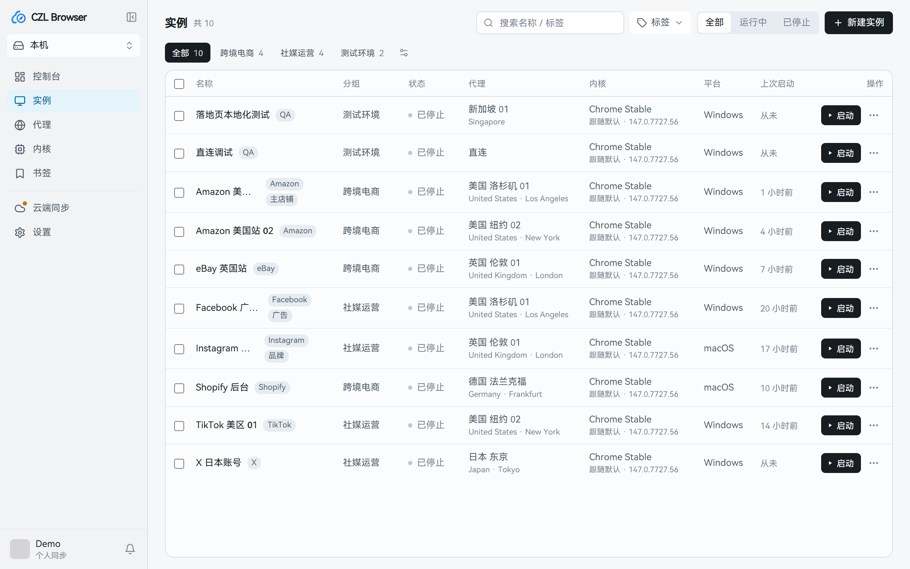
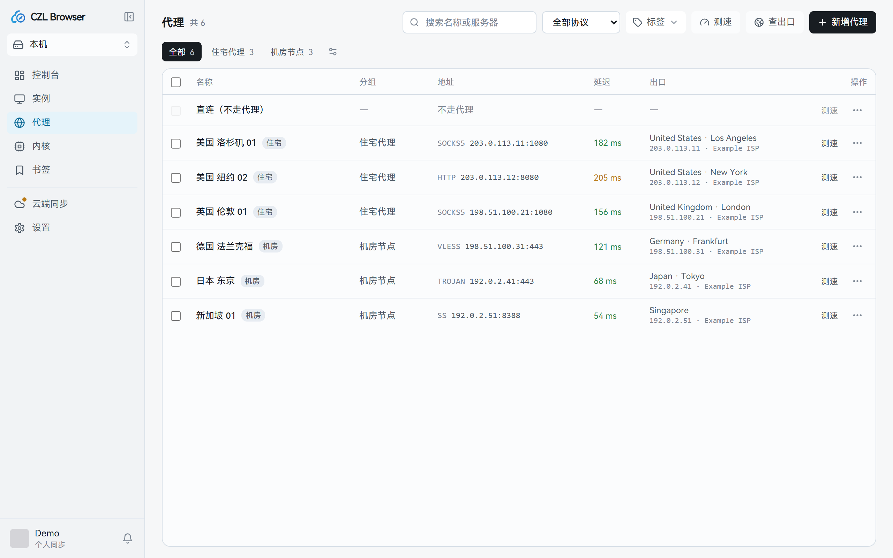
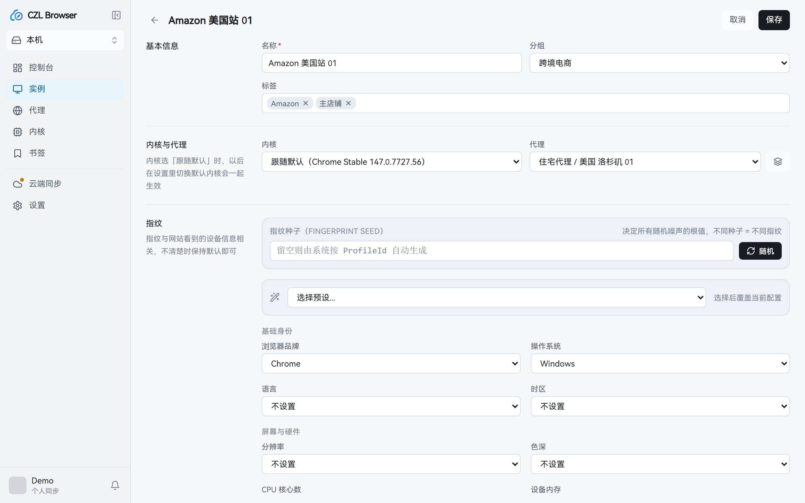

# CZL Browser

**English** | [简体中文](README.zh-CN.md)

> A free Windows desktop browser for multi-account isolation: one isolated browser profile per account, each with its own proxy and fingerprint.

[](https://github.com/woodchen-ink/czlbrowser/releases/latest)
[](https://connect.czl.net/dl/czlbrowser/latest/windows)
[](LICENSE)
[](https://github.com/woodchen-ink/czlbrowser/issues)

CZL Browser runs many fully isolated browser profiles side by side on one Windows PC. Every profile has its own user data, proxy exit, timezone and fingerprint, so accounts stay apart. It is built for cross-border e-commerce, social media operations and localized testing.

- Website: <https://www.czl.net/en/czl-browser>
- Download: <https://connect.czl.net/dl/czlbrowser/latest/windows>



## Features

- **Isolated profiles**: create, clone, start, stop and restart browser profiles. Cookies, cache, storage and logins never leak between profiles.
- **Per-profile proxy**: bind each profile to a proxy from the pool. Supports HTTP, HTTPS and SOCKS5 proxies, with or without username and password (authenticated proxies are relayed through the bundled Xray so Chrome never shows a login prompt).
- **Proxy health checks**: latency and exit IP tests, scheduled automatically.
- **Fingerprint and timezone**: per-profile platform, WebGL / GPU, touch points and more. The timezone follows the proxy exit location automatically, or you can set it by hand.
- **Multiple kernels**: download official Chrome or the open-source [Clearcote](https://github.com/clearcotelabs/clearcote-browser) kernel in the app, keep several versions and pick a default. Profiles follow the default kernel unless you pin one.
- **Quick launch**: press `Ctrl + K` to search profiles by name or tag and open them.
- **Groups and tags**: one group plus any number of tags per profile and proxy, with filters on every list.
- **Backup and restore**: export everything (config, profiles, proxies, login data) into one ZIP and import it on another computer.
- **Automatic updates**: signed update packages, checked and installed from within the app.
- **Optional cloud sync and teams**: sync profiles, proxies and login sessions across computers or share them with a team. Data is end-to-end encrypted on your computer before upload. Profiles in the Local space are never uploaded.

All local features are free, with no profile limits and no ads. Only cloud sync is a paid, optional plan.

## Screenshots

The interface is in Chinese.

| Profiles | Proxies |
| --- | --- |
|  |  |



## Getting Started

### Requirements

- Windows 10 / 11, 64-bit
- 8 GB RAM or more recommended
- 2 GB free disk space or more (each kernel and profile adds to it)

### Install

1. Download the latest installer: <https://connect.czl.net/dl/czlbrowser/latest/windows>
2. Run `CZLBrowser-Setup-<version>.exe`. It installs for the current user into `%LOCALAPPDATA%\CZL\CZL Browser` and does not need administrator rights.
3. Sign in with your CZL account when the app starts.

### First Run

1. Open **Kernels**, download a kernel and set it as the default.
2. Open **Proxies**, add your HTTP / SOCKS5 proxies, then run a speed test.
3. Open **Profiles**, click **New**, and choose a name, group, tags and proxy.
4. Start the profile and visit an IP checker site to confirm the exit IP, region and timezone.

Tip: use one profile per account and keep one stable proxy per profile. Avoid switching a profile's exit IP often.

## Build from Source

CZL Browser is built with [Wails v2](https://wails.io/) (Go backend + React / TypeScript frontend in WebView2).

### Prerequisites

- Go 1.26+
- Node.js 20+ and npm
- Wails CLI v2: `go install github.com/wailsapp/wails/v2/cmd/wails@latest`
- WebView2 Runtime (preinstalled on Windows 11)
- NSIS 3 (only for building the installer)

### Commands

```powershell
# Development with hot reload
pwsh scripts/dev.ps1

# Build desktop\build\bin\czl-browser.exe
pwsh scripts/build.ps1

# Build the installer into dist\ (requires NSIS)
pwsh scripts/build.ps1 -Installer -Version 2026.11.22.1

# Backend tests
cd desktop; go test ./...
```

The proxy runtimes `desktop/bin/xray.exe` and `desktop/bin/sing-box.exe` are included in the repository. Browser kernels are not; download them in the app after it starts. In development, config and data are stored in `desktop/`.

### Project Layout

```
desktop/                 Wails app (Go module)
  main.go                entry, window and tray
  app*.go                methods exposed to the frontend
  internal/              browser, proxy, config, database, backup, update, cloudsync ...
  frontend/              React + TypeScript UI (Vite)
  cmd/updatesign/        signs the update manifest in CI
scripts/                 dev / build scripts and the NSIS installer
```

## Contributing

Issues and pull requests are welcome. See [CONTRIBUTING.md](CONTRIBUTING.md).

- Bug reports: include the app version, Windows version, steps to reproduce and screenshots.
- Feature requests: describe the use case and the behavior you expect.
- For larger changes, open an issue first so we can agree on the approach.

UI text, logs and code comments are written in Chinese. Please follow the existing style.

Please report security issues privately, see [SECURITY.md](SECURITY.md).

## Feedback

- Issues: <https://github.com/woodchen-ink/czlbrowser/issues>
- Live chat on the website: <https://www.czl.net/en/czl-browser>

## Third-party components

Bundled third-party components keep their own licenses: [Xray-core](https://github.com/XTLS/Xray-core) (MPL-2.0) and [sing-box](https://github.com/SagerNet/sing-box) (GPL-3.0). Chrome and Clearcote kernels downloaded in the app follow their own license terms.

## License

[GNU Affero General Public License v3.0](LICENSE).
