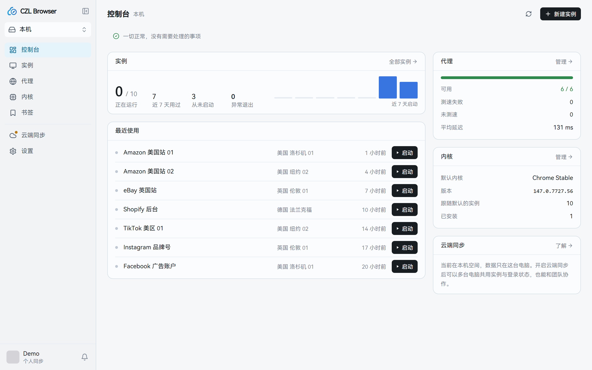
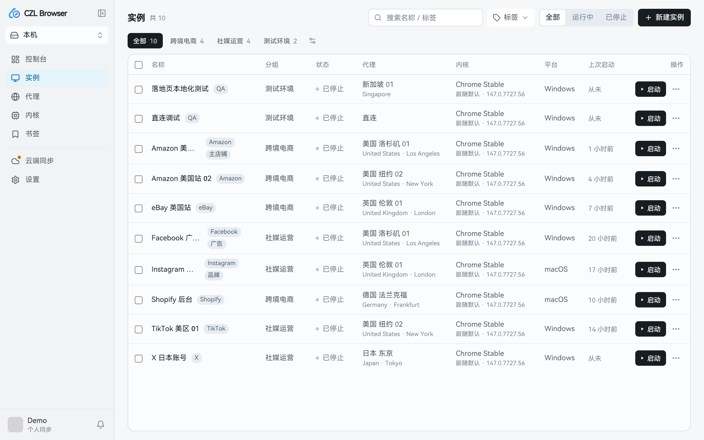
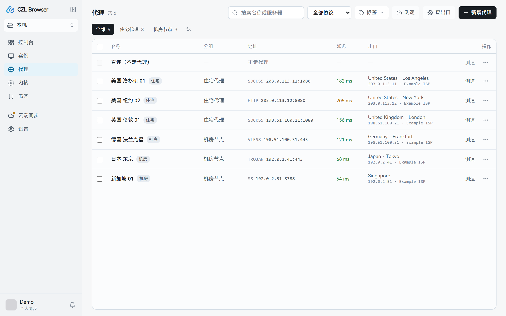
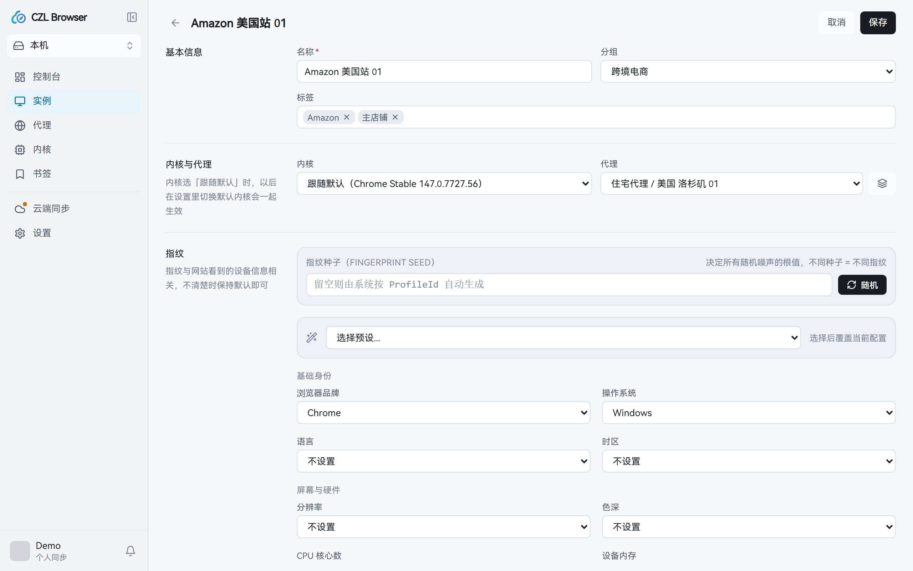

# CZL 浏览器

[English](README.md) | **简体中文**

> 免费的 Windows 多账号隔离浏览器：一个账号一个独立浏览器实例，各自绑定代理与指纹。

[](https://github.com/woodchen-ink/czlbrowser/releases/latest)
[](https://connect.czl.net/dl/czlbrowser/latest/windows)
[](LICENSE)
[](https://github.com/woodchen-ink/czlbrowser/issues)

CZL 浏览器在一台 Windows 电脑上同时运行多个完全隔离的浏览器实例。每个实例有独立的用户数据、代理出口、时区和指纹，账号之间互不串号。适合跨境电商、社媒账号运营与本地化测试。

- 官网：<https://www.czl.net/cn/czl-browser>
- 下载：<https://connect.czl.net/dl/czlbrowser/latest/windows>



## 功能

- **实例隔离**：创建、克隆、启动、停止、重启浏览器实例，Cookie、缓存、存储与登录状态互不相通。
- **独立代理**：每个实例从代理池绑定一个代理。支持 HTTP、HTTPS、SOCKS5 代理，可带账号密码（带认证的代理经内置 Xray 转发，Chrome 不会弹出登录框）。
- **代理检测**：延迟与出口 IP 检测，定时自动执行。
- **指纹与时区**：按实例设置平台、WebGL / GPU、触控点等指纹；时区自动跟随代理出口地区，也可手动指定。
- **多内核**：应用内下载官方 Chrome 或开源的 [Clearcote](https://github.com/clearcotelabs/clearcote-browser) 内核，可并存多个版本并设置默认；实例默认跟随默认内核，也可单独指定。
- **快捷启动**：`Ctrl + K` 按名称或标签搜索实例并打开。
- **分组与标签**：实例和代理各有一个分组和任意多个标签，所有列表都能筛选。
- **备份与恢复**：把配置、实例、代理和登录数据导出为一个 ZIP，在另一台电脑上导入。
- **自动更新**：签名校验的更新包，在应用内检查并安装。
- **可选的云同步与团队**：在多台电脑之间同步实例、代理和登录状态，或与团队共享。数据在本机加密后才上传（端到端加密）；「本机」空间里的实例永远不上传。

本机功能全部免费，不限实例数量，没有广告。只有云同步是按需开通的付费功能。

## 界面预览

| 实例列表 | 代理池 |
| --- | --- |
|  |  |



## 快速开始

### 系统要求

- Windows 10 / 11，64 位
- 建议 8 GB 以上内存
- 建议 2 GB 以上可用磁盘空间（内核与实例会继续占用空间）

### 安装

1. 下载最新安装包：<https://connect.czl.net/dl/czlbrowser/latest/windows>
2. 运行 `CZLBrowser-Setup-<版本号>.exe`。程序按当前用户安装到 `%LOCALAPPDATA%\CZL\CZL Browser`，不需要管理员权限。
3. 启动后使用 CZL 账号登录。

### 第一次使用

1. 进入「内核」，下载一个内核并设为默认。
2. 进入「代理」，添加 HTTP / SOCKS5 代理，然后测速。
3. 进入「实例」，点击「新建」，填写名称、分组、标签并选择代理。
4. 启动实例，访问任意 IP 检测网站，确认出口 IP、地区和时区。

建议一个账号一个实例、一个实例一个稳定代理，不要频繁切换同一实例的出口 IP。

## 从源码构建

CZL 浏览器基于 [Wails v2](https://wails.io/)（Go 后端 + React / TypeScript 前端，运行在 WebView2 中）。

### 依赖

- Go 1.26+
- Node.js 20+ 与 npm
- Wails CLI v2：`go install github.com/wailsapp/wails/v2/cmd/wails@latest`
- WebView2 Runtime（Windows 11 已预装）
- NSIS 3（仅打包安装程序时需要）

### 命令

```powershell
# 开发模式（热更新）
pwsh scripts/dev.ps1

# 构建 desktop\build\bin\czl-browser.exe
pwsh scripts/build.ps1

# 打包安装程序到 dist\（需要 NSIS）
pwsh scripts/build.ps1 -Installer -Version 2026.11.22.1

# 后端测试
cd desktop; go test ./...
```

代理运行时 `desktop/bin/xray.exe` 与 `desktop/bin/sing-box.exe` 已随仓库提供；浏览器内核不在仓库中，启动后在应用内下载。开发模式下配置与数据保存在 `desktop/` 目录。

### 目录结构

```
desktop/                 Wails 桌面端（Go module）
  main.go                入口、窗口与托盘
  app*.go                暴露给前端的方法
  internal/              browser、proxy、config、database、backup、update、cloudsync 等
  frontend/              React + TypeScript 界面（Vite）
  cmd/updatesign/        CI 中给更新清单签名
scripts/                 开发 / 构建脚本与 NSIS 安装脚本
```

## 参与贡献

欢迎提交 Issue 和 Pull Request，详见 [CONTRIBUTING.md](CONTRIBUTING.md)。

- 问题反馈：请附上应用版本、Windows 版本、复现步骤和截图。
- 功能建议：请说明使用场景和期望的行为。
- 较大的改动请先开 Issue 对齐方案。

安全问题请不要公开提 Issue，见 [SECURITY.md](SECURITY.md)。

## 反馈

- Issues：<https://github.com/woodchen-ink/czlbrowser/issues>
- 官网在线客服：<https://www.czl.net/cn/czl-browser>

## 第三方组件

随附的第三方组件保留各自的许可证：[Xray-core](https://github.com/XTLS/Xray-core)（MPL-2.0）、[sing-box](https://github.com/SagerNet/sing-box)（GPL-3.0）。应用内下载的 Chrome 与 Clearcote 内核遵循其各自的许可条款。

## 许可证

[GNU Affero General Public License v3.0](LICENSE)。
